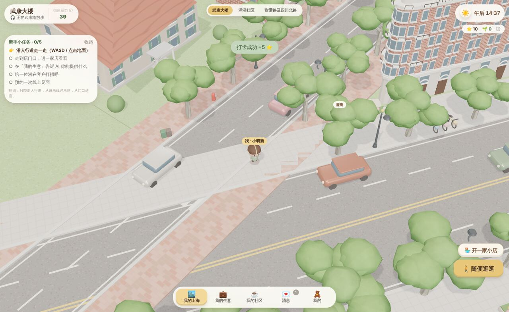
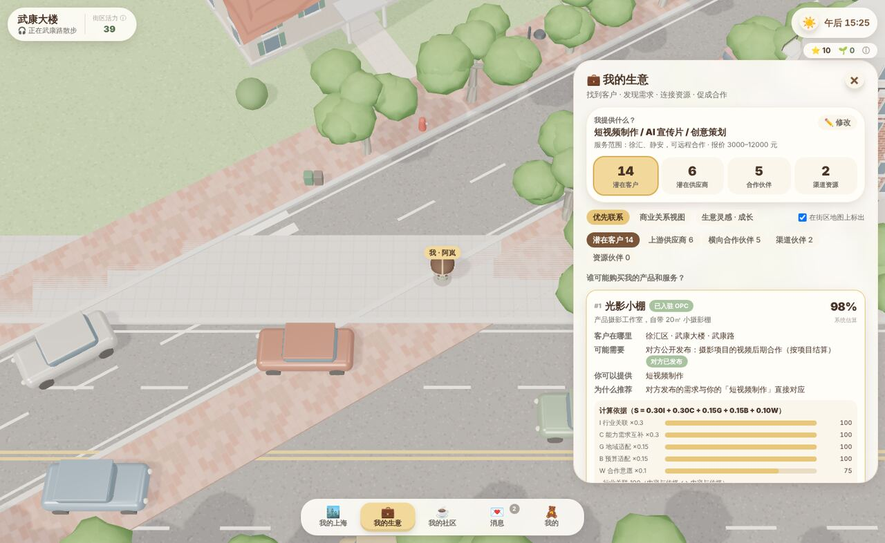
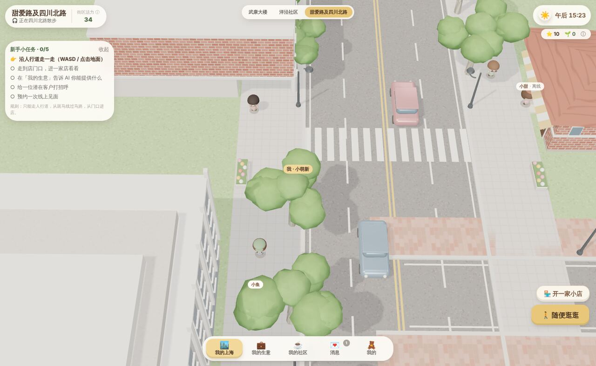
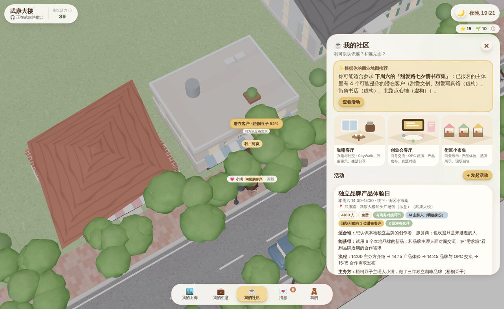

# 三邻邦（OPC Town）

> **v1.0 正式后端**：手机号 / 微信扫码注册登录、所有数据入库、隐私保护（手机号与二维码绝不外露）、管理员数据看板（注册 / 活跃 / PV / UV / 模块与按钮点击 / 留微信号点击）、消息审查、PPT / PDF / Word 开店资料解析、用户私信。见 [docs/BACKEND.md](docs/BACKEND.md)。

> 一个让生意自然发生的城市生活游戏。
> **游戏负责让人愿意留下，AI 负责让关系产生价值，商业系统负责让价值变成收入。**

这是 Phase 1「可玩城市原型」+ 核心故事 Demo 的可运行代码。它完整演示了一条故事：

> 一个普通人进入上海武康路，创建自己的小人，走进一家咖啡馆，发现一个潜在合作伙伴。
> AI 分析两人的能力与需求，推荐合作，双方打招呼，预约线上会议。主理人离线时，AI 分身继续接待。
> 最后，双方的店铺之间出现一条柔软发光的商业连接线。

<p>




</p>

> **v0.5 · 三邻邦**（街坊邻里 · 上下游邻居 · 同行邻伴）：
> 1. **🔗 产业链黄页 + 上下游速配**：电商直播带货及出海、非遗手艺、教育培训三条完整产业链（上游 / 中游 / 下游 / 服务支撑，箭头标明流动的是货、素材、订单还是学员）；街区店铺与个人放在对应环节，“我”自动或手动放到链上并高亮；速配上游供货、下游客户、同环节伙伴、服务商；缺口环节提示招募。
> 2. **🏷️ 服务商展位（抢位）**：每环节 2 个、7 天、先到先得、满员候补，明确标注推广，不参与匹配分。
> 3. **📋 机会广场 / 公告栏**：招标项目（发布 → 投标 → 选标）、推广接单（推广码 → 作品 → 验收）、灵活用工（投递 → 邀约）；发布审核拦截刷单 / 保证金 / 押金 / 培训费；街区里有实体公告栏。
> 4. **🎮 街区生活**：车辆沿曲线转弯、隧道进出；公园绿地；打工挣游戏钞票与小店消费（与真实机会分开）。
> 需求核对见 [docs/REQUIREMENTS_CHECK.md](docs/REQUIREMENTS_CHECK.md)。

> **V2 设计整改**（对照评审意见）：
> 1. **三条初始街道**：武康大楼（淮海中路 × 武康路）、洋泾社区、甜爱路及四川北路，可在顶部切换。
> 2. **城市规则**：道路按横断面建模（建筑退界 | 人行道 | 路缘石 | 机动车道 | …），导航网格 + 碰撞：只能走人行道，从斑马线过街，从门口进店；树、路灯、花箱、单车、骑楼柱都有碰撞；车辆按车道右侧通行并礼让斑马线上的行人。
> 3. **美术**：梧桐 / 香樟 / 桂花 / 银杏资产（树干 + 分枝 + 层叠树冠，3 种形态变体）；武康大楼按“船形转角 + 石材基座拱廊 + 红砖主体 + 白色顶层与栏杆”重建；石库门、骑楼、Art Deco、新村住宅、菜场；沥青 / 铺装 / 砖墙 / 玻璃 / 车漆分材质；共享单车、消防栓、邮筒、公交站、停车位等生活资产。
> 4. **商业地图推倒重做**：「我的生意」以客户为默认视图，每个潜在客户回答“是谁 / 在哪里 / 可能需要什么 / 我能提供什么 / 为什么推荐”；已发布需求与系统推测严格区分；同一主体可有多条业务关系；区分已入驻 OPC / 已入驻商家 / 未入驻公开信息 / 个人；可在 3D 街区上标出客户位置。
> 5. **社区**：三类空间定位明确，活动包含地点、适合谁、流程、主办方、参加者、截止、退款等；根据商业地图推荐“现场可能有你潜在客户”的活动。
> 6. **界面**：地图为主体，面板改为侧边抽屉 / 底部弹层；“街区活力”公开计算依据；星星与成长值说明获取与用途；消息按真人私聊 / AI 接待 / 商业邀约 / 合作申请 / 会议 / 活动 / 订单分类，并标注“需要本人处理”。

## 快速开始

> **完整的、可直接运行的启动步骤（含后端、管理后台、上线配置）见 [docs/START.md](docs/START.md)。** 一句话：`npm install && ADMIN_PHONES=13900000000 npm start`，打开 http://localhost:8787 。

```bash
cd town
npm install
npm run dev        # http://localhost:5180
```

不需要任何 API Key：第一版 AI（画像提取、匹配、Agent 接待）是离线、可解释、可测试的规则引擎，
接口已抽象为 `AiProvider`，后续可切换到 Python + FastAPI + 国内合规大模型（设置 `VITE_AI_BASE_URL`）。

```bash
npm test           # 61 个单元测试：道路规则（人行道/斑马线/门口/碰撞）、客户优先匹配、Agent 权限、连接状态机、经济隔离
npm run build && npm run preview   # 另开终端：
npm run e2e        # Playwright 跑完整演示故事并截图到 e2e/screenshots/
```

操作：WASD / 方向键走路，Shift 跑步，空格蹦一下，点击地面自动走过去，滚轮缩放；手机上用左下角摇杆。

## v1.8.0 更新（开放内测准备）

- **首屏提速**：点「出发」到出现界面，中端手机（4 倍降速模拟）从 4.9 秒降到 0.8 秒——只编译当前街区；几何判断去掉三角函数与临时对象；生产环境不逐个读取着色器日志；圆角方块几何体缓存；选身份时后台预热场景代码与默认街区。手机自动用「手机画质」（分辨率上限 1.5、不开最贵的环境光遮蔽、阴影贴图减半、视距略短）。
- **界面去重**：右上角只剩一个天气图标（晴天夜里显示月亮，点一下预览昼夜）+ 时间 + Lv + ⭐；打工的钞票 / 体力只在打工任务条里显示。
- **路牌减密**：只在路口立牌、相互间隔 30–45 米，路段中间每 140 米一块；各街区路牌减少约四分之三。
- **打个飞的**：改成纯 CSS / SVG，蓝天、三层云、Q 版小飞机（圆滚滚、舷窗笑脸、粉色小翅膀、转动螺旋桨）同一帧出现，不再等加载。
- **真实用户蓝字优先**：真实用户开的店（后端）与自己的店，招牌、搜索结果、小地图、需求大厅、创意广场、私信里统一蓝字（#1A56DB），并排在最前；图例注明。
- **地图纵览**：小地图旁「🏪 N」→ 本街区与全部城市的真实 OPC / 演示店铺 /【例】/ 黄金位 / 空铺；「📈 本周新增」（只算真实用户，7 天内开的店）可一键打个飞的过去，或在小地图上标出。
- **1 分钟开张**：OPC 主理人 / 投资人一进街区就弹出：上传公司（机构）介绍或产品介绍 → 自动提炼店名、介绍、类别、产品，预填开店向导，并选好离你最近的空铺；投资人的类别为「投资与孵化」（【投】黑屋顶）。
- **公司主页式店铺**：真实用户的店是一张完整的公司主页：封面 → 介绍视频 → 公司简介 → 产品与服务 → 产品资料 → 路演 PPT（服务器自动把 PPT 转成 PDF 在线翻看）→ 正在寻找的合作 → 私信。店主在「我的」里上传视频（≤200MB，带进度条）、路演 PPT、产品资料。
- **店铺治理**：管理后台新增「店铺治理」：下架商品 / 视频 / 演讲稿、关店整改、恢复营业；每次处理都会给店主发一条委婉友善的整改提醒（「消息」顶部），并写入审计日志；被下架的资料对外不可访问。
- **管理后台入口**：「我的」里新增「🛠️ 管理后台」：正式版管理员直接打开 /admin.html；离线演示版在游戏里打开同一套界面（演示数据）。
- **发布包**：只保留最近两个版本，打包脚本自动清理更早的。

## v1.7.0 更新

- **真实比例（1 单位 = 1 米）**：以前建筑被压成真实的约 45%（层高 1.35 米、门 1.5 米），人比门还高。现在住宅层高 3 米、底层商铺 3.6 米、门 2.25 米、窗约 1.1 × 1.5 米；路名牌按上海实物约 1.0 × 0.33 米、杆高 3.2 米；梧桐长到三四层楼高；砖块按真实尺寸（约 0.25 × 0.077 米）。俯视时挡住角色的楼会平滑“降墙”露出角色，走开后再升回去。
- **人车互等卡住**：以前车头前方 1.7 米内有人就刹停，人站在车头侧边被车身挡住、车又在等人，两边互相等。现在车只为挡在行驶路线正前方的人停车（新增单元测试：旧逻辑 7 个街区全部卡死，新逻辑全部开走）；人被车挡住时站着等而不是原地踏步；脱困不会借机穿过斑马线或车。
- **随便逛逛（城市漫步）**：串起附近 3–5 个地方（地标、【例】示范店、公园、正在进行的活动），顺路排序；自动切到跟随视角，镜头顺着走路方向转；每站停下面向目标、弹出讲解卡（进去看看 / 继续逛），8 秒后自动去下一站；方向键、摇杆或「⏹ 停止逛逛」随时接管，结束后恢复原视角。
- **画质**：砖墙、青砖、瓦片、地砖、沥青、墙面都自动生成法线与粗糙度贴图（砖缝、瓦楞有真实凹凸，阳光斜照有明暗）；下雨时路面变湿能倒映天空与灯光；夜里窗户亮暗错落；调色略提对比与饱和。3D 标签不再盖住界面按钮。
- **体积**：去掉没用到的依赖；前端库移到 devDependencies，服务器部署 `npm ci --omit=dev` 即可；截图改为 JPG（4MB → 0.6MB）；发布包里的自检截图压成 960 宽 JPG。游戏本体仍是一个约 2MB 的 HTML。

## v1.6.0 更新

- **视角与画质**：左下角 👁️（或 V 键）在「俯视 → 跟随 → 第一人称」之间切换。跟随是过肩视角（隔着楼或树冠时镜头自动拉近 / 降到树冠下）；第一人称视线约 1.3 米，拖动鼠标或手指看四周，W / S 沿视线前后、A / D 横移、Q / E 转身，走路有轻微起伏。天空改为物理大气散射（太阳位置跟当地时间、天气改变浑浊度），夜里有星空，雾的距离随视角调整。「我的」里新增「极致画质」：4K 阴影、全分辨率高质量环境光遮蔽、更远视距与更高分辨率。
- **物理世界**：树的碰撞半径跟树的大小一致（以前大树也只有 0.3 米，看起来走进了树干）；撞到树、路灯这类圆形障碍会贴着边滑过去；按着方向 0.8 秒没动自动脱困；公交站棚 4 米内不再种树（以前会夹出只能原路退回的死角）。车辆：静止车距 2.2 → 2.6 米，并加了一层“绝不接触”的安全网（每一步之后若两车车身含 0.15 米缓冲相碰，就把撞上去的那辆退回并停住）。压力测试：7 个街区各 8 分钟、行人随机过马路、帧时长随机，0 次重叠，安全网 0 次触发。
- **打个飞的**：改成真正的 3D 穿云——追尾镜头跟着小飞机高速穿过程序生成的积云（顶部亮白、底部蓝灰），下方是云海，有阳光逆光、速度线与翼尖尾迹，进云瞬间白闪，下降时云层变薄俯冲穿出；整体节奏从 1.45 秒缩短到约 1.2 秒。

## v1.5.0 更新

- **首屏减负**（内测反馈“一大坨挤在一起”）：新手任务、小地图默认收成小按钮（带未完成数），展开状态会被记住；右上角时间 / 天气 / 等级合并成一行；服务中心、打工移进左下工具条；右侧按钮变小并排；去掉引导页更新说明；手机顶部不再换行重叠。首屏常驻元素从约 10 组减到 6 组。
- **创意广场**（机会 → 💡 创意广场）：发布创意可选公开展示（审核：违规、留手机号 / 微信会被拦截）；点「🤖 怎么落地」→ AI 落地教练给出一句话定位、从想法到真实的 5 步（每步有过关标准和系统入口）、上游 / 下游 / 同行怎么做，以及系统里每个环节的资源（入驻店铺、服务商、投资方，一键打个飞的过去），并附最接近的已审核生态位与市场价值。

## v1.4.0 更新

- **智能生态位**（产业链 → ✨ 智能生态位）：根据 OPC 的营业范围、产品与公司介绍、上传资料、能力画像自动生成上下游 / 供应链 / 多元化方向，先问 3 个小问题（拿手能力 / 拓展方向 / 市场范围）+ 自由补充，开了店会记到店铺资料里；按匹配度降序给 6 个；丢弃即补位，收藏进收藏夹可打标签；生成即审核（合规红线、经营资质、估算可信度、一人可交付、数据来源）；市场价值按自下而上 × 自上而下三角验证估算年营收（默认中国，本地业务标本城市，可出海可切全球）。后端接口 `POST /api/eco/niches`。详见 [docs/ECOSYSTEM.md](docs/ECOSYSTEM.md)。

## v1.2.0 更新

五座城市（上海 / 北京南锣鼓巷 / 深圳华强北 / 长沙五一商圈 / 成都春熙路 · 太古里，真实路名与城市建筑特色）；全站身份色（例 粉 / 企 蓝 / 投 黑 / 品 金 / 其他 紫，屋顶与服装一致）；「买」：搜索按评价分（评分 + 信用等级 + 活跃度）排序、打个飞的直达店门口、聊一聊（在线直接聊 / 不在线留需求）、达成初步合作放礼花、对聊店铺上方小爱心；「逛」：街区动态、城市切换；「跟」：每个街区正在进行的活动（围观 / 报名 / 弹幕）；当地时间昼夜、每天凌晨 3 点查天气预报（晴 / 阴 / 雨 / 雪）；六种身份 × 7 天新手任务。买逛跟梳理见 `docs/BUY_BROWSE_FOLLOW.md`。

## v1.1.0 更新

真实路名与公园名、每街区 10%【例】示范店（蓝 / 红 / 绿屋顶区分例 / 企 / 个人）、右下角「今天来找什么」需求框、六种身份与着装（男女可选）、更立体的树、七种车型、镜头与小地图缩放。详见 `docs/REQUIREMENTS_CHECK.md`。

## 这一版做了什么

| 模块 | 已实现 | 说明 |
| --- | --- | --- |
| 城市生活 | ✅ | 三条街道（武康大楼 / 洋泾社区 / 甜爱路及四川北路）；导航网格与碰撞；车辆与行人；前景建筑自动剖切；昼夜循环；打卡与偶遇 |
| Q 版角色 | ✅ | 大头小身体、走路摇晃、跑步弹跳、开心蹦跳；6 种生活标签（不是职业审核） |
| 萌化反馈 | ✅ | 遇见朋友冒爱心、撞路灯“啵”地弹回、咖啡香气、奶油信封飞行、握手、开张金币星星、AI 分身小机器人标识 |
| 我的生意（客户优先） | ✅ | 一句话自述 → 结构化画像（需确认）→ 潜在客户 / 上游供应 / 横向合作 / 渠道 / 资源；五个问题；证据分级；可解释评分 S=0.30I+0.30C+0.15G+0.15B+0.10W；价值流向分层视图 |
| 商务连接 | ✅ | 打招呼 / 奶油邀请函 → 对方接受 → 双方同意才交换联系方式 → 15/30/60 分钟线上见面 → 双方本人确认合作记录 |
| AI 分身 | ✅ | L1 接待 / L2 商务 / L3 永远本人确认；只引用已确认价格；身份透明；主理人接管；转交与审计 |
| OPC 开店 | ✅ | 四步五分钟开店；区分个人创业主页 / 自述经营主体 / 已认证企业；创业状态 |
| 社区 | ✅ | 咖啡客厅 / 创业会客厅 / 街区小市集；任何人发起活动；AI 社区主持人；赞助明确标注且可关闭 |
| 三个创新 | ✅ | 生意灵感（探索建议）、组队地图（我愿意加入）、成长地图（按真实进展点亮） |
| 经济 | ✅ | 街区星星 / 创业成长值不可兑换人民币；代码层面不提供兑换、转账、买排名能力 |
| 数据层 | 🟡 | 本地存储；Supabase / PostgreSQL 表结构与 RLS 见 `supabase/migrations/0001_init.sql` |
| 多人实时 / 支付 / 第二街区 | ⏳ | Phase 3，按验证结果投入 |

**演示数据声明**：街上的小满、阿强、鹿鹿等人物与店铺全部是虚构的演示角色，界面上有“演示”标签，
不对应任何真实个人或商户；他们对招呼的回应由演示脚本模拟，真实系统中由对方本人操作。

**建筑与地图声明**：三条街道的路网角度、道路宽度、周边建筑均为示意（洋泾社区与甜爱路的道路名、建筑为典型街景示意）；重点建筑只收录较确定的公开信息，不确定项写“待核实”；
Q 版模型状态为“待人工审核”，需对照实景照片校准；坐标为约百米级近似值，只用于微缩布局，不可用于导航。
正式上线前需取得地图数据授权，遵循测绘资质与服务条款，详见 [`docs/RISKS.md`](docs/RISKS.md)。

## 目录结构

```
town/
├─ src/
│  ├─ domain/              # 纯业务逻辑（不依赖 3D / React），全部有单测
│  │  ├─ types.ts          # 核心数据模型（与 SQL 表一一对应）
│  │  ├─ taxonomy.ts       # 能力 / 行业 / 上下游标签表 —— 关系推理的唯一依据
│  │  ├─ commerce.ts       # 客户优先的商业撮合引擎：五类关系 + 五个问题 + 证据分级
│  │  ├─ profileExtractor.ts  # 一句话 → 结构化画像；生意灵感
│  │  ├─ agent.ts          # AI 分身：L1/L2/L3 权限边界
│  │  ├─ introductions.ts  # 打招呼 → 联系方式 → 见面 → 合作记录 状态机
│  │  └─ economy.ts        # 虚拟奖励（与真实货币隔离）
│  ├─ world/               # 街区：道路横断面、建筑、斑马线、门；导航网格（A*）与碰撞
│  │  ├─ districts/        # 武康大楼 / 洋泾社区 / 甜爱路及四川北路
│  │  ├─ build.ts          # 编译街区：人行道、路缘、行道树与街道家具的放置规则、碰撞体、车道
│  │  └─ nav.ts            # 可步行区域分类 + 寻路 + 滑动碰撞
│  ├─ data/
│  │  ├─ geo.ts            # 真实坐标 ↔ 游戏坐标 转换层
│  │  ├─ archives.ts       # 重点建筑数字档案
│  │  ├─ seed.ts           # 虚构经营主体 / 人物 / 店铺
│  │  └─ events.ts         # 社区活动
│  ├─ services/aiProvider.ts  # 可替换的 AI 接口（规则版 / HTTP 版）
│  ├─ store/useTown.ts     # Zustand 全局状态 + 本地持久化
│  ├─ scene/               # React Three Fiber 场景（只负责“看起来”和“摸起来”）
│  └─ ui/                  # Tailwind 奶油风 UI：五个底部入口 + 弹窗
├─ supabase/migrations/    # PostgreSQL 表结构 + 行级安全示例
├─ e2e/demo-story.cjs      # Playwright 演示故事 & 验收
└─ docs/                   # 架构、路线图、风险、AI 编程总提示词
```

更多：[架构与数据模型](docs/ARCHITECTURE.md) · [路线图、验收标准与 KPI](docs/ROADMAP.md) · [风险与合规](docs/RISKS.md) · [AI 编程总控提示词](docs/MASTER_PROMPT.md)
