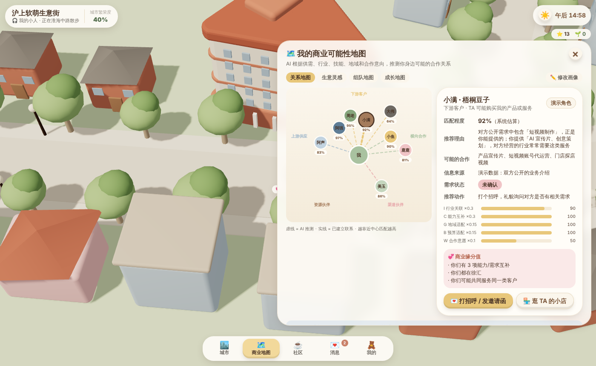
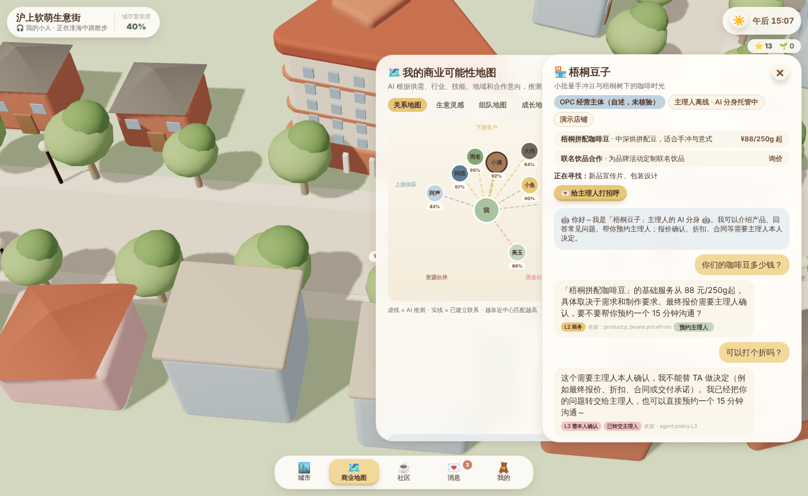

# 沪上软萌生意街 · SHANGHAI OPC TOWN

> 一个让生意自然发生的城市生活游戏。
> **游戏负责让人愿意留下，AI 负责让关系产生价值，商业系统负责让价值变成收入。**

这是 Phase 1「可玩城市原型」+ 核心故事 Demo 的可运行代码。它完整演示了一条故事：

> 一个普通人进入上海武康路，创建自己的小人，走进一家咖啡馆，发现一个潜在合作伙伴。
> AI 分析两人的能力与需求，推荐合作，双方打招呼，预约线上会议。主理人离线时，AI 分身继续接待。
> 最后，双方的店铺之间出现一条柔软发光的商业连接线。

<p>




</p>

## 快速开始

```bash
cd town
npm install
npm run dev        # http://localhost:5180
```

不需要任何 API Key：第一版 AI（画像提取、匹配、Agent 接待）是离线、可解释、可测试的规则引擎，
接口已抽象为 `AiProvider`，后续可切换到 Python + FastAPI + 国内合规大模型（设置 `VITE_AI_BASE_URL`）。

```bash
npm test           # 37 个单元测试：匹配公式、信息不足、Agent 权限、连接状态机、经济隔离、坐标转换
npm run build && npm run preview   # 另开终端：
npm run e2e        # Playwright 跑完整演示故事并截图到 e2e/screenshots/
```

操作：WASD / 方向键走路，Shift 跑步，空格蹦一下，点击地面自动走过去，滚轮缩放；手机上用左下角摇杆。

## 这一版做了什么

| 模块 | 已实现 | 说明 |
| --- | --- | --- |
| 城市生活 | ✅ | 武康路—安福路—乌鲁木齐中路连续微缩街区；5 栋重点建筑 Q 版模型；程序化街屋、梧桐树、路灯；昼夜循环；CityWalk 自动漫步；打卡与偶遇 |
| Q 版角色 | ✅ | 大头小身体、走路摇晃、跑步弹跳、开心蹦跳；6 种生活标签（不是职业审核） |
| 萌化反馈 | ✅ | 遇见朋友冒爱心、撞路灯“啵”地弹回、咖啡香气、奶油信封飞行、握手、开张金币星星、AI 分身小机器人标识 |
| AI 商业可能性地图 | ✅ | 一句话自述 → 结构化画像（需确认）→ 五种关系 → 可解释评分 S=0.30I+0.30C+0.15G+0.15B+0.10W，信息不足不打分，商业缘分值 |
| 商务连接 | ✅ | 打招呼 / 奶油邀请函 → 对方接受 → 双方同意才交换联系方式 → 15/30/60 分钟线上见面 → 双方本人确认合作记录 |
| AI 分身 | ✅ | L1 接待 / L2 商务 / L3 永远本人确认；只引用已确认价格；身份透明；主理人接管；转交与审计 |
| OPC 开店 | ✅ | 四步五分钟开店；区分个人创业主页 / 自述经营主体 / 已认证企业；创业状态 |
| 社区 | ✅ | 咖啡客厅 / 创业会客厅 / 街区小市集；任何人发起活动；AI 社区主持人；赞助明确标注且可关闭 |
| 三个创新 | ✅ | 生意灵感（探索建议）、组队地图（我愿意加入）、成长地图（按真实进展点亮） |
| 经济 | ✅ | 街区星星 / 创业成长值不可兑换人民币；代码层面不提供兑换、转账、买排名能力 |
| 数据层 | 🟡 | 本地存储；Supabase / PostgreSQL 表结构与 RLS 见 `supabase/migrations/0001_init.sql` |
| 多人实时 / 支付 / 第二街区 | ⏳ | Phase 3，按验证结果投入 |

**演示数据声明**：街上的小满、阿强、鹿鹿等人物与店铺全部是虚构的演示角色，界面上有“演示”标签，
不对应任何真实个人或商户；他们对招呼的回应由演示脚本模拟，真实系统中由对方本人操作。

**建筑与地图声明**：重点建筑只收录较确定的公开信息（名称、地址、年代、建筑师等），不确定项写“待核实”；
Q 版模型状态为“待人工审核”，需对照实景照片校准；坐标为约百米级近似值，只用于微缩布局，不可用于导航。
正式上线前需取得地图数据授权，遵循测绘资质与服务条款，详见 [`docs/RISKS.md`](docs/RISKS.md)。

## 目录结构

```
town/
├─ src/
│  ├─ domain/              # 纯业务逻辑（不依赖 3D / React），全部有单测
│  │  ├─ types.ts          # 核心数据模型（与 SQL 表一一对应）
│  │  ├─ taxonomy.ts       # 能力 / 行业 / 上下游标签表 —— 关系推理的唯一依据
│  │  ├─ matching.ts       # 商业可能性地图：五种关系 + 可解释评分
│  │  ├─ profileExtractor.ts  # 一句话 → 结构化画像；生意灵感
│  │  ├─ agent.ts          # AI 分身：L1/L2/L3 权限边界
│  │  ├─ introductions.ts  # 打招呼 → 联系方式 → 见面 → 合作记录 状态机
│  │  └─ economy.ts        # 虚拟奖励（与真实货币隔离）
│  ├─ data/
│  │  ├─ geo.ts            # 真实坐标 ↔ 游戏坐标 转换层
│  │  ├─ buildings.ts      # 建筑数字档案、街道骨架、铺位、CityWalk 路线
│  │  └─ seed.ts           # 虚构演示角色 / 店铺 / 活动
│  ├─ services/aiProvider.ts  # 可替换的 AI 接口（规则版 / HTTP 版）
│  ├─ store/useTown.ts     # Zustand 全局状态 + 本地持久化
│  ├─ scene/               # React Three Fiber 场景（只负责“看起来”和“摸起来”）
│  └─ ui/                  # Tailwind 奶油风 UI：五个底部入口 + 弹窗
├─ supabase/migrations/    # PostgreSQL 表结构 + 行级安全示例
├─ e2e/demo-story.cjs      # Playwright 演示故事 & 验收
└─ docs/                   # 架构、路线图、风险、AI 编程总提示词
```

更多：[架构与数据模型](docs/ARCHITECTURE.md) · [路线图、验收标准与 KPI](docs/ROADMAP.md) · [风险与合规](docs/RISKS.md) · [AI 编程总控提示词](docs/MASTER_PROMPT.md)
